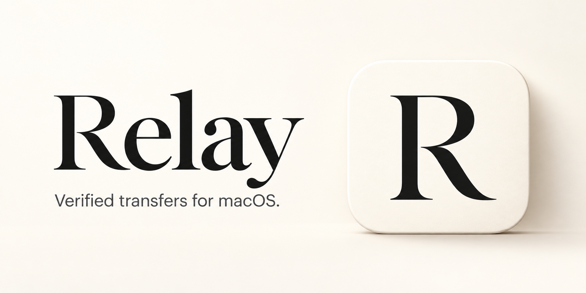

# Relay

A native Mac app for transferring files between your Mac and external drives, with verification built into every transfer.

**[Download Relay](https://github.com/smailkorchi/Relay/releases/latest)** · [Relay 1.1.0 for Apple Silicon (.dmg)](https://github.com/smailkorchi/Relay/releases/download/v1.1.0/Relay-1.1.0-macOS-arm64.dmg)

Apple Silicon · Targets macOS 14 or later · Native Liquid Glass on macOS 26 and later

## Install

1. Open the downloaded disk image and drag **Relay** into **Applications**.
2. Open Relay from Applications.
3. If macOS blocks the first launch, go to **System Settings → Privacy & Security** and follow the **Open Anyway** flow for Relay. See [Apple’s instructions](https://support.apple.com/en-us/102445).

This release is locally signed with an ad-hoc signature and **is not notarized by Apple**. The first-launch approval is specific to Relay; no system-wide security changes are needed.

## Four steps, one verified transfer

1. **Direction** — choose **Mac to Drive** or **Drive to Mac**.
2. **Files** — drop one file or a batch from Finder, or use **Choose Files**.
3. **Destination** — choose a drive or folder. Relay measures its read and write speed with a temporary test file, then removes it.
4. **Review** — choose **Keep originals** or **Move originals to Trash**, then transfer.

The transfer screen shows the current file, copying and verification progress, measured speeds, verified-file counts, elapsed time, and an estimate when available. Completion has its own screen, with access to the destination and verification receipt.

## What Relay checks

- **Exact copies.** Relay calculates a source SHA-256 checksum during copying, flushes writes, then reads the destination back without the filesystem cache and compares it. A file is complete only after verification succeeds.
- **Existing files stay protected.** Relay rejects filename collisions and changed sources or destinations instead of overwriting them.
- **Recoverable interruptions.** Temporary I/O errors can receive up to three attempts per unfinished file. The recovery screen offers manual retry when safe, reusing unchanged verified copies. A reconnected drive receives additional checks before work resumes.
- **Careful original handling.** Originals move to macOS Trash only after the whole batch is verified. Relay never permanently deletes originals or empties Trash. If that final step is interrupted, the receipt records any originals already moved.
- **Local receipts.** JSON receipts record filenames, paths, byte counts, SHA-256 checksums, and original-file handling. Find them from the outcome screen or **Help → Show Verification Receipts**.

## Limits

Relay accepts individual regular files and batches of files. Folder transfers and symbolic links are not supported. Resume information is retained for the current app session; quitting and reopening does not restore a pending transfer.

Verification proves that the saved copy matches its source. It cannot repair an already corrupted source or establish whether a document or installer itself is valid. A read-back pass also does not guarantee against a later hardware failure.

## Build and verify

Use Xcode 26 or later, or the corresponding Command Line Tools. The app has no third-party package dependencies. Verification scripts also use Python 3.

```sh
./scripts/package.sh
open dist/Relay.app
```

Run the core checks locally without XCTest:

```sh
./scripts/verify-core.sh
```

AppModel navigation and recovery checks are available through `./scripts/verify-app-model.sh`. External-drive fixtures are **opt-in**: set both `RELAY_TEST_VOLUME` and `RELAY_TEST_VOLUME_UUID` to a drive you authorize for temporary test data. The harness checks that the mounted volume matches the supplied UUID before writing. Offline runs skip external fixtures; test-owned data is cleaned up and unrelated files are preserved.
